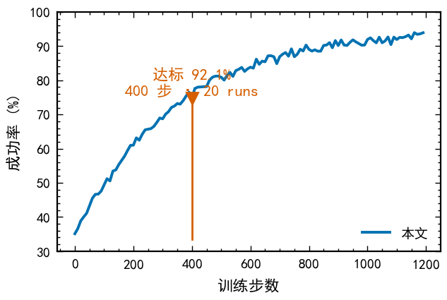
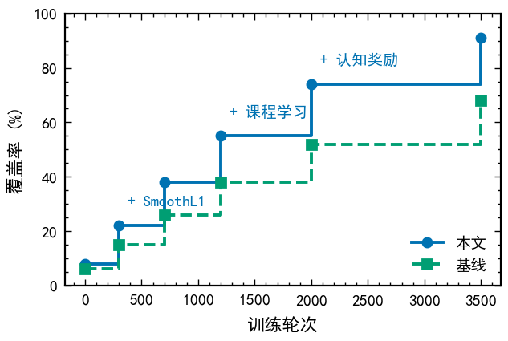
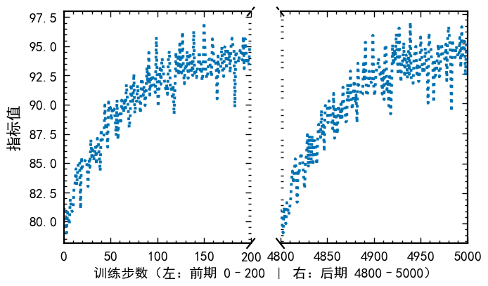
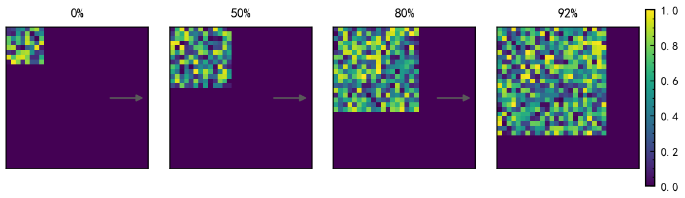

> 🕒 v3 · 2026-10-08 20:40 · dsh-agent ｜ 变更：诚实化定位（中文字体支持来自 SciencePlots）+ 新增效果截图区 ｜ 上一版：v2 · 2026-10-08 20:28

# sci-figures — 科研作图技能包（DSH Skill）

给 [DeepSeek Harness](https://github.com/deepseek-ai/deepseek-harness) 用的科研作图技能：从「这张图要证明什么」到成图，含期刊样式工具箱、四个可复用图式、六条出图路线实测对比。

**它做什么**：把科研出图的**图式**（怎么用图形讲一句话）和**踩坑**固化成可复用资产，并在 [SciencePlots](https://github.com/garrettj403/SciencePlots) 之上封装一个默认栈（字体回退链 + 关掉 `text.usetex` 冲突 + 矢量字体嵌入 + 色盲安全配色）。

> ⚠️ **中文字体支持主要来自 SciencePlots 的 `cjk-sc-font`**（其官方文档已支持简体中文），本技能做的是在其之上少踩坑，**不是它的替代品**。本技能独有的部分是**五个图式**与**踩坑清单**。

## 装

本仓库根目录**就是**技能目录。clone 后放进 DSH 的**用户级技能根**：

```bash
git clone https://github.com/yanggaihao5-sys/dsh-sci-figures.git
cp -r dsh-sci-figures ~/.dsh/skills/sci-figures
```

Windows（PowerShell）：

```powershell
git clone https://github.com/yanggaihao5-sys/dsh-sci-figures.git
Copy-Item -Recurse dsh-sci-figures "$env:USERPROFILE\.dsh\skills\sci-figures"
```

依赖（按需，缺了会自动回退不报错）：

```bash
pip install scienceplots matplotlib            # 期刊样式（推荐）
pip install plotly kaleido plotnine altair vl-convert-python   # 可选：另外五条路线
```

## 有什么

| 文件 | 内容 |
|---|---|
| `SKILL.md` | 技能主文件：五步流程、硬规则、命名约定、更新协议 |
| `scripts/mpl_style.py` | 工具箱：`use()` / `save()` / `save_pgf()` / `PALETTE` + 四个图式函数 |
| `references/图式库.md` | 图式库：钉子 · 阶梯 · 滑轴 · 魔方串烧（append-only，持续追加实例） |
| `references/工具链.md` | 六条出图路线实测对比（SciencePlots / pgf / TikZ / Plotly / Plotnine / Altair）+ 实测坑 |

## 效果

示例图全部由 `examples/make_examples.py` 用固定 seed 生成，**可复跑**（不是手放的死图）：

| 钉子（钉住关键点） | 阶梯（分阶段抬升 + 事件标注） |
|---|---|
|  |  |

| 滑轴（断轴看全貌 + 尾部） | 魔方串烧（多快照共享色标） |
|---|---|
|  |  |

复跑：

```bash
python examples/make_examples.py
```

## 自检

```bash
python scripts/mpl_style.py     # 四个图式各出一张，验证工具箱可用
```

## 一句话选法

- 图里有**中文**（中文期刊 / 毕业论文）→ 本技能，`use()` 已处理字体回退与 usetex 冲突
- 论文是 **LaTeX** 写的 → 再出 `.pgf`（`save_pgf()`），字体与正文完全一致
- 纯英文 + 目标是 Nature/CNS 系版式 → 用第三方 `nature-figure` 类技能

## License

MIT
