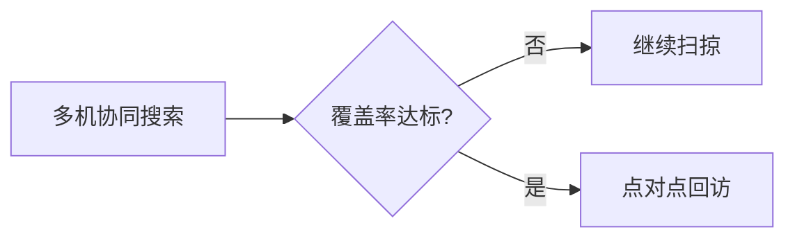

> 🕒 v1 · 2026-10-08 20:09 · dsh-agent ｜ 变更：初稿：六条出图路线实测（脱敏版）

# 出图工具链（每条路线均**实测通过**）

> **起因**：想知道「主流的画图路线各是什么、什么时候该换」。→ 把主流替代**逐个装到本机并真跑出图**，不只看文档。
> 下表每一行都有**实测产物**，不是推荐清单。

| # | 路线 | 实测 | 什么时候用它 | 一句话代价 |
|---|---|---|---|---|
| ① | **SciencePlots**（期刊样式） | ✅ PDF 10.4 KB，字体嵌入 | **默认就用它** —— 期刊版式（栏宽/字号/刻度朝内/线宽）一行搞定 | 零（`SciencePlots 2.2.2`） |
| ② | **matplotlib pgf 后端** | ✅ `.pgf` 103 KB | **论文本身是 LaTeX 写的** → 字体与正文完全一致 | 需本机 LaTeX |
| ③ | **TikZ / PGFPlots 直编** | ✅ `pdflatex` 出 PDF 24 KB | 需要**公式/精确排版/示意结构**的图（pgfplots 是出版物天花板） | 写 LaTeX，慢 |
| ④ | **Plotly + Kaleido** | ✅ HTML 4.8 MB + **SVG 6.8 KB** | **探索阶段**（缩放/悬停/多序列），或交付可交互网页 | 大文件；静态导出靠 kaleido |
| ⑤ | **Plotnine**（ggplot 移植） | ✅ PNG 76 KB（分面） | **声明式**画分面图（`facet_wrap` 一条语句，免手排 GridSpec） | 与 matplotlib 混用要 `draw()` |
| ⑥ | **Altair + vl-convert** | ✅ SVG 14 KB + **PDF 21 KB** | 想要**图即 JSON**（可存可复现、可嵌网页） | 数据量有上限（默认 5k 行） |

实测时的版本（供参考，非硬要求）：`matplotlib 3.10.6` · `seaborn 0.13.2` · `scienceplots 2.2.2` · `plotly 7.1.0` · `kaleido` ·
`plotnine 0.15.8` · `altair 6.3.0` · `vl-convert 1.9.0` · LaTeX = **MiKTeX 25.12**（pgf / pgfplots 已装）。

---

## 怎么选（判据，别凭喜好）

```
数据图（曲线/柱/热力/散点）
├─ 要投稿的正式插图 ──→ ① SciencePlots 样式（默认）+ 本工具箱的四图式函数
│                        └─ 论文是 LaTeX → 再加 ② pgf 后端（字体一致，编辑部最认）
├─ 还在探索/要挑图 ────→ ④ Plotly（交互看，选定了再用 ① 复刻成矢量）
├─ 多分面/多条件对比 ──→ ⑤ Plotnine（声明式，比手排 GridSpec 快）
└─ 图要当数据存/嵌网页 → ⑥ Altair（JSON 即图）

结构图（方法总览/流程/架构）──→ Mermaid（零依赖；见下）
精确排版的示意图/带公式 ─────→ ③ TikZ/PGFPlots
```

> 🔴 **别为了"高级"而换工具**：同一份数据，① 出图 3 秒、③ 出图 30 秒 —— **图的"高级"来自版式与图式选择，不是来自引擎**。

---

## ① SciencePlots（默认路线）

```python
import sys, pathlib
sys.path.insert(0, str(pathlib.Path.home() / ".dsh/skills/sci-figures/scripts"))
from mpl_style import use, save
print(use(style="science"))      # -> science+ieee+no-latex+cjk-sc-font
```
- `style` 可选：`science`（期刊通用）/ `nature`（无衬线更紧凑）/ `cjk`（纯中文图）/ `plain`（旧行为）。
- **未装 SciencePlots 时自动回退 plain，不报错**。
- 🔴 **坑**：SciencePlots 的 `science` 样式**默认 `text.usetex: True`**（它假定你在 LaTeX 里用）。
  中文标签 + usetex 会失败/出豆腐块 → `use()` **已显式关掉**（本工具箱的 rc 最后覆盖样式）。
  要真 usetex：自己 `plt.rcParams["text.usetex"]=True`（且图里别用中文）。
- 🔴 **坑**：CJK 字体子集**可能没有 U+2212（真减号 `−`）** → 图里**用 ASCII `-`**；
  刻度负号由 `axes.unicode_minus=False` 自动处理（已设）。

## ② matplotlib pgf 后端（LaTeX 论文首选）

```python
from mpl_style import use, save_pgf
use(); fig, ax = ...; save_pgf(fig, "figs/fig3.pgf")
```
LaTeX 里：`\usepackage{pgf}` + `\input{fig3.pgf}`。
- **字体与论文正文同一套** → 这是编辑部最认的做法（字号不会因为缩放而错）。
- 前提：本机 LaTeX 可用。首次跑若卡住 → 见文末「MiKTeX 坑」。

## ③ TikZ / PGFPlots（图表天花板，写 LaTeX）

最小可编译模板（实测 `pdflatex` 通过）：
```latex
\documentclass[border=2pt]{standalone}
\usepackage{pgfplots}\pgfplotsset{compat=1.18}
\begin{document}
\begin{tikzpicture}
\begin{axis}[width=7cm,height=4.2cm,xlabel=轮次,ylabel=覆盖率,legend pos=south east,grid=major]
\addplot+[mark=*] coordinates {(0,0.10)(1,0.40)(2,0.70)(3,0.85)(4,0.92)};
\addlegendentry{本文}
\addplot+[mark=square*,dashed] coordinates {(0,0.05)(1,0.25)(2,0.55)(3,0.75)(4,0.88)};
\addlegendentry{基线}
\end{axis}\end{tikzpicture}
\end{document}
```
编译：`pdflatex -interaction=nonstopmode -halt-on-error t1.tex`

## ④ Plotly（探索）

```python
import plotly.graph_objects as go
fig = go.Figure(); fig.add_trace(go.Scatter(x=x, y=y, name="ours"))
fig.update_layout(template="plotly_white")
fig.write_html("explore.html")     # 交互
fig.write_image("fig.svg")         # 静态（kaleido）
```
- HTML **4.8 MB/图**（内嵌 plotly.js）→ 别往论文目录堆，放 `_explore/`。
- 静态导出实测可用（SVG 6.8 KB）；PDF 更小更清。

## ⑤ Plotnine（声明式分面）

```python
from plotnine import ggplot, aes, geom_line, facet_wrap, theme_bw
(ggplot(df, aes("e", "c", color="方法")) + geom_line() + facet_wrap("~方法") + theme_bw()
 ).save("fig.png", width=7, height=3, dpi=300)
```
- 好处：**分组/分面/统计变换用语法表达**，不用手排 `GridSpec`；坏处：与 matplotlib 生态混用要 `draw()` 取回 figure。

## ⑥ Altair / Vega-Lite（图即 JSON）

```python
import altair as alt
alt.Chart(df).mark_line(point=True).encode(x="e", y="c").properties(width=320, height=200).save("fig.svg")
```
- 声明式 + **图就是 JSON**（可版本化、可嵌网页、可被别的工具再渲染）；`vl-convert` 负责出 SVG/PDF。

## 结构图：Mermaid（零依赖）


- **方法总览 / 流程图 / 时序图**首选：写在 .md 里直接渲染，不用出图文件。

---

## 坑（实测）

- 🔴 **MiKTeX 首次运行会挂起**（在非交互子进程里建用户配置/装包时会等输入）。
  **处置**：① 先把 `[MPM]AutoInstall=1` 打开；② 手动在终端跑一次 `pdflatex` 让它把配置/字体建完；
  ③ 脚本调 `pdflatex` 一律加 `-interaction=nonstopmode` **并设外部硬超时**（别裸等）。
- 🔴 **SciencePlots 的 `science` 默认开 usetex** → 中文图必须配 `no-latex`（`use()` 已处理）。
- ⚠️ **CJK 字体缺 U+2212** → 正文用 ASCII `-`。
- ⚠️ **别把 `fig.write_html` 的交互图当投稿件**：投稿要矢量 PDF/SVG，且**字体嵌入**（`pdf.fonttype=42`，已设）。
- ⚠️ **同一批图必须同一样式**：混用 `science` 与 `plain` 会让字号/线宽不一致，审稿人一眼看出。
